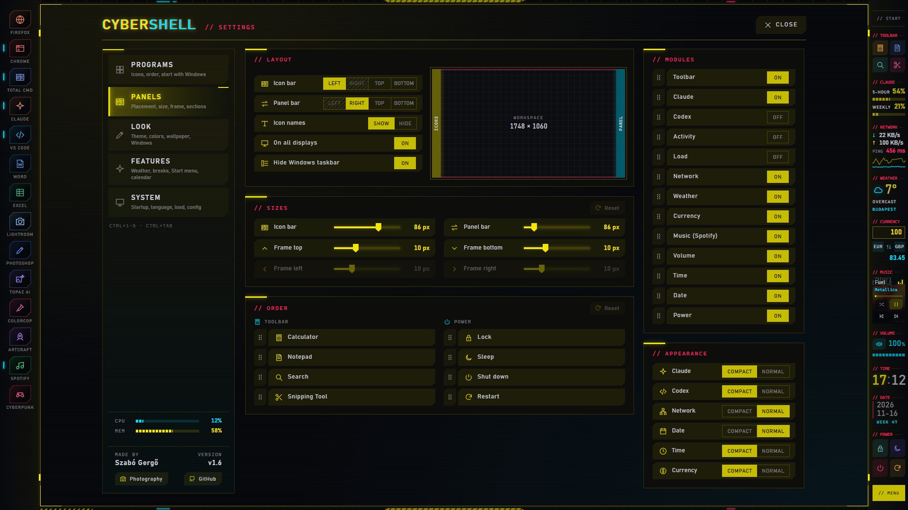

# CyberShell

**Cyberpunk asztali felület és programindító Windowsra**

[English](README.md) · **Magyar**

A CyberShell neonfényes cyberpunk HUD-dá alakítja a Windows asztalát. Az egyik szélen a programsáv, a másikon az élő információs panel, a képernyő körül vékony, világító keretek, középen pedig az ablakaid. Ez több egy sima témánál. A CyberShell átveszi a tálca, a Start menü, a keresés és a widgetek feladatát, így az egész felület egységes, nem a gyári felületre húzott máz.

## Főbb jellemzők

- **Megvan a hangulata.** A sötét téma a Cyberpunk 2077 neonfényeit idézi, a világos a Ghost in the Shell látványvilágát. Az *Auto* beállítás napkelte és napnyugta szerint vált köztük, a *Windows* a Windows világos vagy sötét módját követi.
- **Leváltja a gyári felületet.** Az Ikonok sáv élő ablakelőnézetet ad, a `Win` billentyű pedig a CyberShell saját Start menüjét és keresőjét nyitja. A kereső számol, parancsot futtat, őrzi a vágólap előzményeit, és ékezetek nélkül vagy betűszóval is megtalálja, amit keresel.
- **Minden egy pillantásra.** Óra, naptár Google Naptár-támogatással, időjárás, Spotify-vezérlés, hangerő, főkapcsoló, a Claude és a Codex használati korlátai, és piros jelzés, ha megszakad az internetkapcsolat.
- **Összhangban a Windows-zal.** Kérésre a Windows sötét/világos módja, kiemelőszíne és a Windows Terminal színsémája is a témával vált, az aktív ablak körül pedig neonkeret fut.
- **Hosszú munkanapokra.** A szünetemlékeztető és az aktivitás-visszaszámláló szól, ha ideje felállni.
- **Átalakítható.** A panelek bármelyik képernyőszélre kerülhetnek, a szekciók sorrendje húzással állítható. A füles beállítási felületen szinte minden állítható, és minden egyetlen `config.json`-ba kerül; a megjelenés komponensenként egy CSS-fájlban, a `Ctrl+Alt+R` pedig újratölti az eredményt.
- **Kicsi és biztonságos.** Rust nyelven íródott, telepítés nélkül, a saját mappájából fut. A `Ctrl+Alt+Q` kilép, és mindent visszaállít; ha a program összeomlik, egy figyelő folyamat visszaadja a tálcát.

**Miben más?** A skinrendszerek widgeteket tesznek az asztalra, a tálcamódosítók a Windows meglévő sávját festik át, az indítók pedig csak keresnek. A CyberShell az egész réteget lefedi: a tálca, a Start menü, a kereső és az információs panel egy arculatot és egy beállításfájlt használ, minden monitoron.

## Gyors indítás

1. Tedd a `CyberShell.exe`-t egy mappába, és indítsd el. Első induláskor létrehozza a `%LOCALAPPDATA%\CyberShell` mappában a `config.json`-t és a `wallpapers` mappát.
2. Jobb alul a **// MENÜ** gombbal állíthatod a témát, a nyelvet, a programokat és a paneleket.
3. A `Ctrl+Alt+Q`-val lépsz ki, és minden visszaáll.

Nincs még `CyberShell.exe`? [Fordítsd le forrásból](docs/hu/development.md#fordítás-forrásból). Először csak belenéznél? A `preview.html` böngészőben megnyitva demóadatokkal mutatja a teljes képernyőt (lásd: [A forráskód felépítése](docs/hu/development.md#a-forráskód-felépítése)).

## Dokumentáció

- [Első lépések](docs/hu/getting-started.md): indítás, kilépés, indulás a géppel, hibaelhárítás
- [Beállítások](docs/hu/settings.md): a MENÜ oldal
- [Felület](docs/hu/interface.md): az Ikonok sáv és az információs panel
- [Start menü és kereső](docs/hu/start-menu.md): a Start menü, a kereső, a számológép és a vágólap-előzmények
- [Claude-használat](docs/hu/claude-usage.md): honnan jönnek a korlátok
- [Testreszabás](docs/hu/configuration.md): programok hozzáadása, `config.json`, megjelenés
- [Fejlesztés](docs/hu/development.md): fordítás és a forráskód felépítése

## Licenc

A CyberShell mindenkinek ingyenes, otthon és munkahelyen is, a forráskódja pedig nyilvános. Használhatod, módosíthatod és megoszthatod, de eladni vagy pénzt kérni érte nem szabad, a támogatási és tárhelydíjat is beleértve. A feltételek a [LICENSE](LICENSE) fájlban vannak: MIT licenc a Commons Clause kikötéssel.

> A v1.3-tól CyberShell (korábban CyberHub). Az első indításkor a program szabályosan leállítja a még futó CyberHubot, átveszi az adatmappáját (a claude.ai-belépéssel együtt) és az „Indulás a géppel” beállítását.

*A CyberShell független projekt, amelyet a Cyberpunk 2077 és a Ghost in the Shell ihletett. Nincs kapcsolata a CD PROJEKT RED-del, sem egyik mű jogtulajdonosával.*
