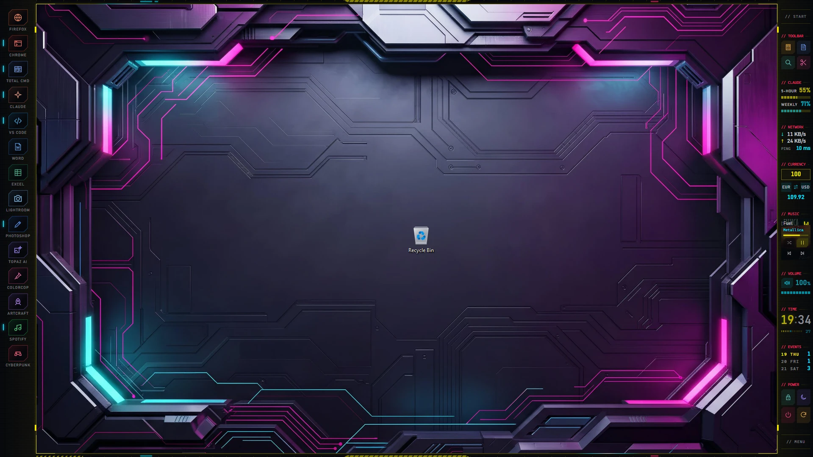
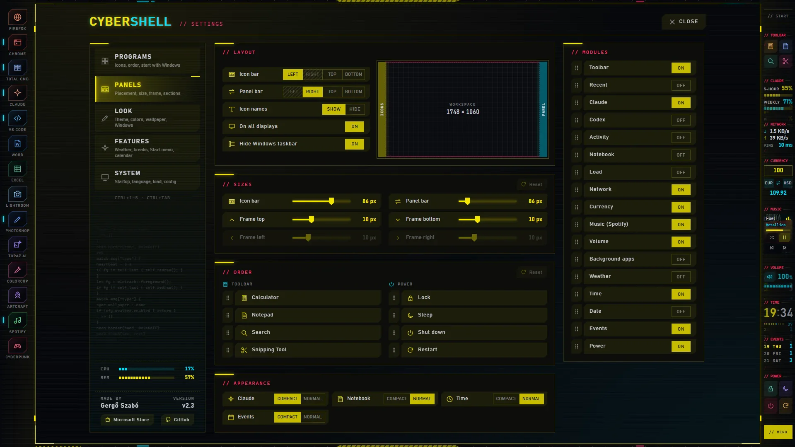

# CyberShell

**Cyberpunk desktop shell and launcher for Windows**

**English** · [Magyar](README.hu.md)

> **Available in the [Microsoft Store](https://apps.microsoft.com/detail/9nw7gcgdgr71).** Install it from there for automatic updates, or build it from source yourself.

  
  

CyberShell turns the Windows desktop into a neon cyberpunk HUD: a program bar on one edge, a live info panel on the other, thin glowing frames around the screen, and your windows in the middle. It is more than a theme. CyberShell takes over the job of the taskbar, the Start menu, search and the widgets, so the whole interface follows one design instead of a skin laid over the stock one.

## Highlights

- **Looks the part.** The dark theme is Cyberpunk 2077-style neon, the light theme draws on Ghost in the Shell. *Auto* switches between them at sunrise and sunset, *Windows* follows the Windows light or dark mode.
- **Replaces the stock interface.** The Icons bar shows live window previews, and the `Win` key opens CyberShell's own Start menu and search. The search calculates, runs commands, keeps a clipboard history, and finds what you type even without accents or with just an acronym.
- **Everything at a glance.** Clock, calendar with Google Calendar support, upcoming events, a notebook with a to-do list, your frequently used programs, weather, Spotify controls, volume, Bluetooth device batteries, power buttons, your Claude and Codex usage limits, and a red alert when the internet connection drops.
- **In step with Windows.** On request the Windows dark/light mode, accent color and Windows Terminal color scheme switch with the theme, and a neon border runs around the active window.
- **Built for long sessions.** A break reminder and an activity timer tell you when it is time to stand up.
- **Yours to change.** Put the panels on any screen edge and reorder the sections by dragging. Almost everything can be set in the tabbed settings, and it all lives in one `config.json`; the look in one CSS file per component, and `Ctrl+Alt+R` reloads the result.
- **Small and safe.** Written in Rust, no installer, it runs from its own folder. `Ctrl+Alt+Q` quits and restores everything; if the program ever crashes, a watchdog gives the taskbar back.

**What sets it apart.** Skin systems put widgets on the desktop, taskbar tweaks restyle the bar Windows already has, and launchers only search. CyberShell covers the whole layer in one design: taskbar, Start menu, search and info panel share one look and one settings file, on every monitor.

## Quick start

1. Put `CyberShell.exe` in a folder and start it. On first start it creates `config.json` and the `wallpapers` folder in `%LOCALAPPDATA%\CyberShell`.
2. Open **// MENU** at the bottom right to set the theme, language, programs and panels.
3. Quit with `Ctrl+Alt+Q`; everything is restored.

No `CyberShell.exe` yet? [Build it from source](docs/en/development.md#building-from-source). Want a look first? `preview.html` shows the whole screen with demo data in a browser (see [Source code layout](docs/en/development.md#source-code-layout)).

## Documentation

- [Getting started](docs/en/getting-started.md): start, exit, start with Windows, troubleshooting
- [Settings](docs/en/settings.md): the MENU page
- [Interface](docs/en/interface.md): the Icons bar and the info panel
- [Start menu and search](docs/en/start-menu.md): the Start menu, search, calculator and clipboard history
- [Claude usage](docs/en/claude-usage.md): where the limits come from
- [Configuration](docs/en/configuration.md): adding programs, `config.json`, styling
- [Development](docs/en/development.md): building and source code layout

## License

CyberShell is free for everyone, at home and at work, and its source code is public. You may use, change and share it, but you may not sell it or charge money for it, support and hosting fees included. The terms are in [LICENSE](LICENSE): the MIT License with the Commons Clause condition.

> From v1.3 the app is called CyberShell (formerly CyberHub). On first start it shuts down a still running CyberHub cleanly and takes over its data folder (including the claude.ai sign-in) and its "Start with Windows" setting.

*CyberShell is an independent project inspired by Cyberpunk 2077 and Ghost in the Shell. It is not affiliated with CD PROJEKT RED or the rights holders of either.*
